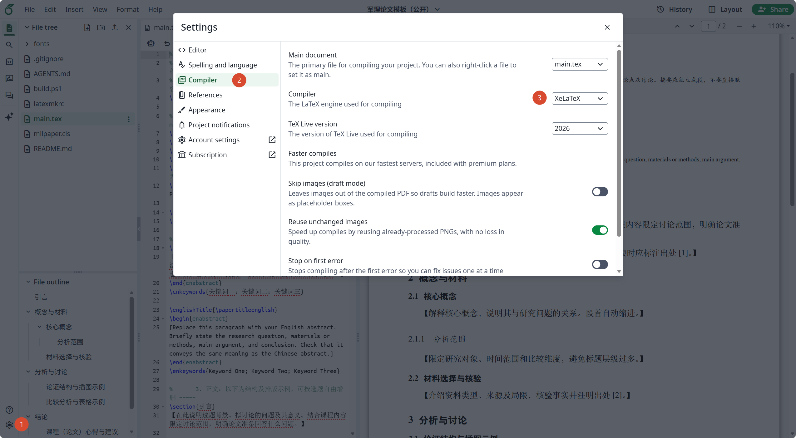

# 海宁校区军事理论课程论文模板

适用于浙江大学海宁校区2025级军事理论课程论文写作的 LaTeX 模板。提供中英文摘要、三级标题、图表、参考文献、课程心得及 GAI 使用说明示例。

参考模板为学在浙大平台的 Word 版本文档，**按照任课老师偏好将正文设置为单栏并放大到小四号字**。

## 在 Overleaf 上使用

1. 登录你的 Overleaf. 然后访问 [Overleaf项目链接](https://www.overleaf.com/project/6ae5c7311d8d805bbb42fec3/share#9bb399c9e3fd1a8ff052fb036e77c18b9850ff9d9b3285b9)

   > 如果链接失效，也可按下方 GitHub 使用说明下载源码，再上传到 Overleaf。

2. 拷贝项目（左上角 File - make a copy）

   > 如果 `make a copy` 呈灰色，请先登录 Overleaf. 

3. **在左下角设置 → Compiler（编译器）中，选择 XeLaTeX。**

   

4. 填写 `main.tex` 开头“基本信息”区的姓名、学号和中英文题目，开始创作。没有副标题时将 `\papersubtitle` 的内容留空。

5. 在 `references.bib` 中填写真实文献，正文通过 `\cite{引用键}` 引用。Overleaf 会自动运行 Biber；首次编译或修改文献后，如出现旧编号或问号，可选择重新从头编译。

## 从 GitHub 使用

在仓库页面选择 **Code → Download ZIP**，解压后可直接在本地编译；也可将源码文件夹重新压缩为 ZIP，在 Overleaf 首页选择 **New Project → Upload Project**。

## 在本地编辑和编译

见后文：本地编译。或者直接扔给你的 AI Agent.

## 文件说明

| 文件 | 用途 |
| --- | --- |
| `main.tex` | 论文入口；填写个人信息、标题和全部内容 |
| `references.bib` | 文献数据库；填写作者、题名、期刊、年份等信息 |
| `milpaper.cls` | 页面、字体、标题、摘要、页眉与参考文献的排版设置 |
| `latexmkrc` | 将本地默认编译器设为 XeLaTeX |
| `build.ps1` | Windows 本地编译脚本 |
| `README.assets/` | 使用说明（本文件）中的截图，与你的论文无关 |

## 常用写法和约定

- 中文题目、副标题和英文题目在开头集中设置，PDF 标题元数据会自动更新。
- 标题：`\section{一级标题}`、`\subsection{二级标题}`、`\subsubsection{三级标题}`。
- 分段：按照模板。段首自动缩进，不必手动加空格。
- 引用：正文写 `\cite{引用键}`，在 `references.bib` 中使用同名条目；文末的 `\printbibliography` 自动生成参考文献表，不再手写 `\bibitem`。
- 图表引用：在图表中设置 `\label{标签}`，正文使用 `\ref{标签}`，不要手工填写图表编号。
- 图片：将图片上传到 `images/`，使用 `\includegraphics[width=.85\textwidth]{images/figure.png}`；须先提供实际文件，再启用该命令。
- 特殊字符：正文中的 `%`、`&`、`_`、`#` 等应分别写作 `\%`、`\&`、`\_`、`\#`；网址可写成 `\url{https://example.com/}`。

示例包含图表浮动环境，最终位置由 LaTeX 根据页面空间安排。遇到引用显示为问号时再编译一次；`latexmk` 会自动完成必要的多次编译。

## 本地编译

安装 TeX Live 2026 或更新版本，包含 XeLaTeX、latexmk、Biber、biblatex、biblatex-gb7714-2015（提供 `gb7714-2025` 样式）、ctex、Fandol、TeX Gyre 和 TikZ。在此目录运行：

```sh
latexmk -xelatex -interaction=nonstopmode -halt-on-error -outdir=build main.tex
```

结果为 `build/main.pdf`。Windows PowerShell 也可直接运行：

```powershell
.\build.ps1
```

脚本的输出同样为 `build/main.pdf`。`latexmk` 会自动运行 Biber 和必要的多轮 XeLaTeX；脚本不修改系统配置，也不执行 Git 同步。修改文献后应重新编译。

清理临时文件但保留 PDF：

```sh
latexmk -c -outdir=build main.tex
```

## 参考文献格式与填写

采用 **GB/T 7714—2025 顺序编码制**，通过 `biblatex` 的 `gb7714-2025` 样式和 Biber 自动生成参考文献。文献按正文首次引用顺序编号，只输出实际引用的条目。

期刊条目的基本结构为：`[序号] 作者. 题名[J]. 期刊全称, 年, 卷(期): 起止页码.` 多名中文作者在成品中以“，”隔开；超过三位时列前三位再加“等”，英文则加斜体 *et al.*。字体、字号仍采用课程模板设置。课程的具体要求优先于样式默认值。

在 `.bib` 数据中，作者之间必须用英文 `and` 分隔；英文姓名推荐写成 `姓, 名`，机构作者用双层花括号，例如 `author = {{发布机构}}`。不要手动输入作者后的“等”、`et al.`、编号或 `[J]` 标识。

```bibtex
@article{my-article,
  author       = {作者甲 and 作者乙 and 作者丙 and 作者丁},
  title        = {论文题名},
  journaltitle = {期刊全称},
  date         = {2026},
  volume       = {12},
  number       = {3},
  pages        = {45--52},
  langid       = {chinese}
}
```

正文写 `\cite{my-article}` 即可引用。页码范围使用 `--`，没有的卷号、期号等字段不要编造；英文文献设置 `langid = {english}`。提供了 DOI、URL 或文章编号的文献，应根据原文如实录入相应字段。

`references.bib` 中的条目全部是虚构的格式示例，提交前请替换为实际阅读、核验和引用的来源，同时删除正文的填写提示与不需要的示例。心得与 GAI 说明按任课教师当次要求填写。全文题目、字数和其他排版要求也以当次课程通知为准。
